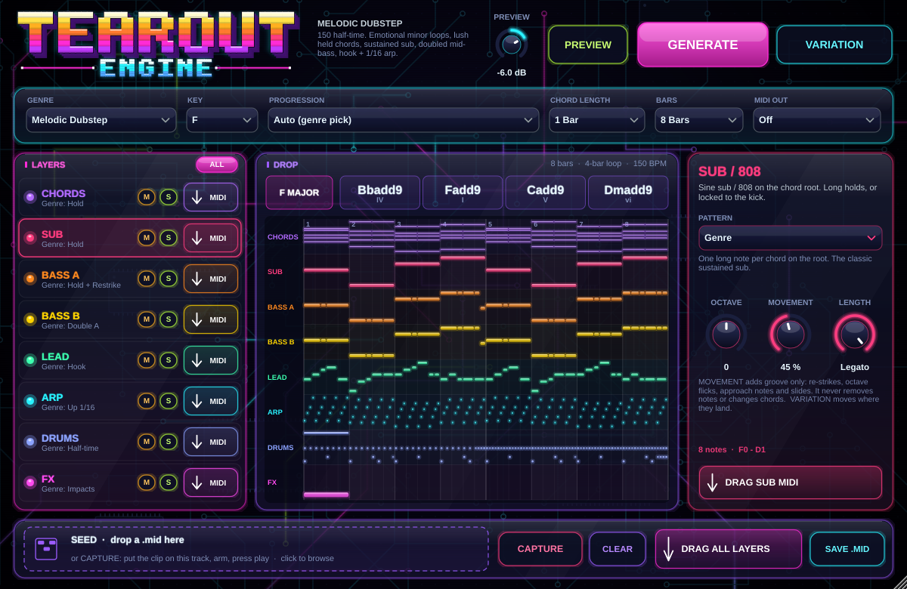

<p align="center"></p>

# TEAROUT ENGINE 1.0

TEAROUT ENGINE is a MIDI generator plugin (VST3 / AU / Standalone) for building drops. It works out the harmony first, then writes the parts of a drop around it: real chord progressions, sustained basses with no gaps, a hook and an arpeggiator. Each layer comes out as its own MIDI clip that you drag into Ableton.

<p align="center"></p>

## What it does

1. **You pick a genre.** The genre sets the drop's rules: Melodic Dubstep, Tearout Dubstep, Riddim, Trap, Hardstyle Techno, or Common (the progressions in every pop song).
2. **It picks a real progression.** There are 28, for example:
   - i–VI–III–VII
   - i–♭II
   - i–VII–VI–V
   - I–V–vi–IV
   
   You can also use the chords of your own seed clip.
3. **It writes 8 separate layers from that harmony.** Each layer has its own pattern, octave, movement and length:

| Layer | Plays |
|---|---|
| **CHORDS** | Holds, 3-3-2 stabs, 1/8 pulse, offbeat chords, half-time stabs, or your seed's chord rhythm. Voice-led, with genre colour (add9, 7ths, octave roots). |
| **SUB / 808** | The chord root. Either long holds, or re-struck on every kick (808 style), offbeat (hardstyle), or following BASS A. |
| **BASS A** | The main mid-bass. Long hold, hold + restrike, 3-3-2 ride, 4-2-2 ride, 1/8 pump, offbeat, triplet bounce, or your seed's rhythm. **Gapless.** |
| **BASS B** | The second bass sound. It either **doubles** A, or **takes turns** with A (answers, swap every hit, restrikes, half & half). A + B always add up to one continuous line. |
| **LEAD** | A 2-bar hook, repeated and answered, with chord tones on beats 1 and 3. Or long notes, a 1/8 riff, call & response, or your seed's top line. |
| **ARP / PLUCK** | A real arpeggiator over the chord tones: up, down, up-down, 2 octaves, 1/8, 1/16T or 3-3-2 pluck. It restarts on every chord. |
| **DRUMS** | Drum Rack notes: half-time, half-time heavy, trap, four-on-floor, hardstyle or backbeat. |
| **FX** | Impacts, risers, reverse crashes and sweeps at phrase boundaries. |

**MOVEMENT** (per layer) adds groove only:
- re-strikes of notes that are already sounding
- short octave flicks
- an approach note into the next chord
- 1/32 slides at turnarounds

It never removes a note or changes the chords. At 0 you get the pure pattern. **VARIATION** keeps the song and only moves where that groove lands. **GENERATE** gives you a new idea.

The full research behind the rules is in [`docs/DROP_RESEARCH.md`](docs/DROP_RESEARCH.md).

## Using it in Ableton Live 11

1. Install it ([`docs/INSTALL_MAC.md`](docs/INSTALL_MAC.md)), then drop **TEAROUT ENGINE** on a MIDI track.
2. Pick **GENRE**, **KEY** and **PROGRESSION** (★ marks the progressions typical for the genre; *Auto* picks one).
3. Press **PREVIEW** to hear the drop on the built-in preview synth. When Live's transport is running, the preview follows Live.
4. Click a layer and set its **PATTERN**. Use **MOVEMENT** for groove and **LENGTH** (Legato = no gaps).
5. **Drag** a layer's **MIDI** button onto a track to get its clip. Or drag **DRAG ALL LAYERS**, or **SAVE .MID** into a folder.

### Seed clips: get variations of your own idea

Ableton can't drag a clip *directly* into any plugin. So there are two ways in:
- **CAPTURE.** Put your clip on the TEAROUT ENGINE track, press **CAPTURE**, then play. Capture stops when the transport stops.
- **Drop a .mid.** Right-click the clip in Live → *Export MIDI Clip…*, then drop the file on the seed zone (or click the zone to browse).

The seed's **key and chords** become *PROGRESSION = From Seed*. That progression transposes if you change KEY. The seed's **rhythms** drive the *From Seed* patterns of BASS A, LEAD and CHORDS.

**To learn from a stem:** in Live 11, right-click the audio → *Convert Harmony / Melody to New MIDI Track*, then capture that clip.

### MIDI OUT

Set **MIDI OUT** to *Selected Layer* or *All Layers* (channels 1–8) to stream the notes live. To route them, set another MIDI track's *MIDI From* to this track and pick TEAROUT ENGINE in the second menu.

Whether Live lets you route MIDI out of a plug-in depends on the plug-in format, so it may not work. Dragging clips always works and is the main workflow.

## Building

This is a CMake project. JUCE 8 is downloaded automatically, or you can point `TE_JUCE_DIR` at a local checkout.

```sh
cmake -S . -B build -DCMAKE_BUILD_TYPE=Release
cmake --build build --config Release --target TearoutEngine_VST3 TearoutEngine_AU TearoutEngine_Standalone
```

For a macOS universal build, add `-DCMAKE_OSX_ARCHITECTURES="arm64;x86_64"`.

Pushing to GitHub runs `.github/workflows/build.yml`:
- engine tests and example MIDI
- a Linux plugin build, processor tests and a GUI snapshot
- **macOS universal VST3 / AU / Standalone** (ad-hoc signed and checked with `auval`)
- **Windows VST3 / Standalone**

Download the zips from the run's *Artifacts*. A `v*` tag also attaches them to a GitHub Release.

## Tests

- `te_tests` (engine, no JUCE) runs about 11 million checks over every genre × progression × chord length × bar count × movement level × pattern:
  - bass and sub play the root, are monophonic and **gapless**
  - BASS A and B never overlap when they take turns
  - chord, lead and arp notes fit the harmony
  - **movement never removes a base hit or changes the chords**
  - VARIATION keeps the song; holds stay holds
  - seed key / chord detection, MIDI file round trips, and the player (no stuck notes)
- `te_plugin_tests` covers:
  - parameters, preview audio and MIDI out
  - capture from MIDI input
  - seed files
  - save / load state (the restored plugin regenerates the identical drop)
  - drag files and SAVE .MID

## Layout

```
src/core/      engine (plain C++17): Theory, Catalogue (progressions, genres, patterns), Engine, Seed, MidiFile, Synth
src/plugin/    JUCE processor, editor, neon look-and-feel, widgets
tests/         engine tests
tools/         te_cli (dump / examples / render), te_snapshot (GUI to PNG), te_plugin_tests
docs/          research, install guide, logo, screenshot
```

*Built with [JUCE](https://juce.com) (AGPLv3 / JUCE licence). Check JUCE's licence terms before distributing builds.*
